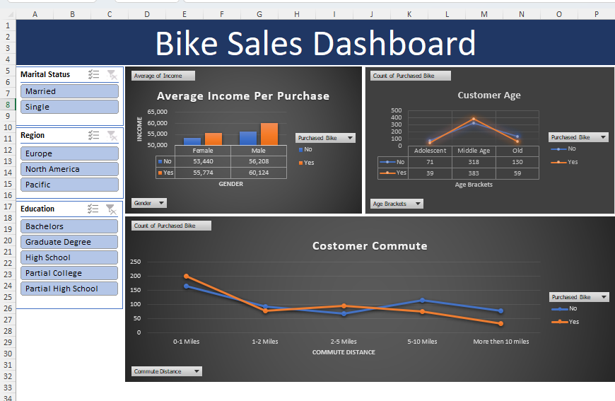

# 🚲 Bike Buyers Analysis – Excel Dashboard Project

An end-to-end data analysis project in **Microsoft Excel** that cleans a customer dataset, explores what drives bike purchases, and presents the findings in an interactive dashboard.

> **Tools:** Microsoft Excel · Data Cleaning · Formulas (`IF`) · Pivot Tables · Pivot Charts · Slicers · Dashboard Design

---

## 📌 Business Problem

A bike retailer wants to understand **which customers are most likely to buy a bike**, so marketing can target the right segments. This project answers:

- Who buys bikes – by age, income, gender, marital status and region?
- Does commute distance or car ownership influence purchase?
- Which segments should marketing prioritise?

## 📂 Dataset

| Item | Detail |
|---|---|
| Source file | `Excel_Project_Dataset.xlsx` |
| Raw records | 1,026 customers |
| Clean records | **1,000 customers** (26 duplicate IDs removed) |
| Fields | ID, Marital Status, Gender, Income, Children, Education, Occupation, Home Owner, Cars, Commute Distance, Region, Age, Purchased Bike |

**Workbook sheets**

| Sheet | Purpose |
|---|---|
| `bike_buyers` | Original raw data (untouched) |
| `Working sheet` | Cleaned data + new `Age Brackets` column |
| `Pivot Table` | 3 pivot tables and pivot charts |
| `Dashboard Sheet` | Final interactive dashboard |

## 🧹 Data Cleaning & Preparation

1. Kept a **raw copy** of the data and worked on a separate sheet.
2. **Removed 26 duplicate records** (by `ID`), leaving 1,000 unique customers.
3. Checked for missing values – none found.
4. **Standardised labels** for readability: `M/S` → `Married/Single`, `M/F` → `Male/Female`.
5. Created an **Age Brackets** column using a nested `IF` formula:
   - Adolescent (0–30) · Middle Age (31–54) · Old (55+)

```excel
=IF(L2>54,"Old 55+",IF(L2>=31,"Middle Age 31-54",IF(L2<31,"Adolescent 0-30","Invalid")))
```

## 📊 Analysis & Dashboard

Three pivot tables feed three charts on the dashboard:

1. **Average income by gender, split by purchase** (bar chart)
2. **Customers by commute distance, split by purchase** (line chart)
3. **Customers by age bracket, split by purchase** (line chart)

Slicers let the viewer filter the dashboard interactively.

<!-- Add your dashboard screenshot below after uploading it to the images folder -->


## 🔍 Key Insights

**Overall:** 481 of 1,000 customers (**48.1%**) purchased a bike.

| Dimension | Finding |
|---|---|
| **Age** | Middle-aged customers (31–54) buy most: **54.6%** conversion vs 35.5% for under-31s and just **31.2%** for 55+. They are also 70% of all customers. |
| **Commute distance** | Short commuters buy more. 0–1 miles: **54.6%**; 2–5 miles: **58.6%**; 10+ miles: only **29.7%**. |
| **Cars owned** | Customers with 0–1 cars buy at **57–61%**; with 2+ cars it falls to **36–39%**. |
| **Income** | Buyers earn slightly more on average (**$57,963** vs **$54,875**). Male buyers average $60,124 vs $55,774 for female buyers. |
| **Marital status** | Single customers convert better (**54.1%**) than married (**42.9%**). |
| **Region** | Pacific leads at **58.9%**; North America is lowest at 43.3%. |
| **Education** | Bachelors / Graduate degree holders buy most (~54–55%); Partial High School lowest (26.3%). |
| **Gender** | Almost no difference (Female 48.9% vs Male 47.4%). |

## 💡 Recommendations

- **Target customers aged 31–54**, the largest and highest-converting group.
- **Focus campaigns near city centres / short-commute areas**, where cycling is practical.
- **Prioritise single customers and households with 0–1 cars.**
- **Invest more in the Pacific region**, which has the best conversion; review the North America approach.
- Don't segment by gender – it has little effect on purchase.

## 🚀 How to Use

1. Download `Excel_Project_Dataset.xlsx` from this repository.
2. Open in Microsoft Excel (2016 or later; slicers required).
3. Go to the **Dashboard Sheet** tab and use the slicers to filter.

## 📁 Repository Structure

```
bike-buyers-excel-dashboard/
├── Excel_Project_Dataset.xlsx
├── images/
│   └── dashboard.png
└── README.md
```

## 🧠 Skills Demonstrated

Data cleaning · Duplicate removal · Nested IF formulas · Pivot Tables & Charts · Slicers · Dashboard design · Customer segmentation · Business insight writing

## 👤 Author

**Sridhar** – Marketing Executive transitioning into Data Analytics
📍 Coimbatore, India · [GitHub](https://github.com/Sridhar-0210) · [LinkedIn](https://www.linkedin.com/in/sridhar-a-570222246/)
